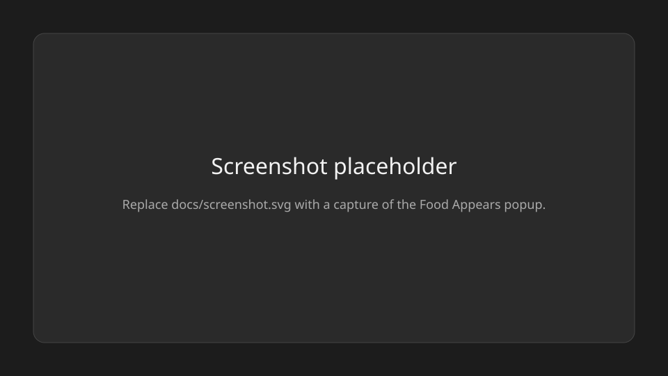

# Food Appears

Bar widget (`jordan.grocy`) for [Omarchy](https://omarchy.org) 4.x. It shows what is in stock on your Grocy server and the shopping list for the following Monday. When you configure Kroger, it can also search one banner store, show regular and promo prices, and add a priced hit to that list.



The image above is a placeholder. Replace `docs/screenshot.svg` with a capture of the popup.

## Install

This checks out tag `v0.4.0` into `~/.config/omarchy/plugins/jordan.grocy`. Run it again to move an existing checkout onto that tag.

```bash
tag=v0.4.0; dest="${XDG_CONFIG_HOME:-$HOME/.config}/omarchy/plugins/jordan.grocy"; mkdir -p "$(dirname "$dest")"; if [ -d "$dest/.git" ]; then git -C "$dest" fetch --depth 1 origin "refs/tags/$tag:refs/tags/$tag" && git -C "$dest" checkout --detach "$tag"; else git clone --depth 1 --branch "$tag" https://github.com/jordanpartridge/omarchy-grocy.git "$dest"; fi
```

Reload the bar after the copy. The plugin id is `jordan.grocy`.

## Uninstall

```bash
omarchy plugin remove jordan.grocy
```

That unloads the plugin and moves its folder to a timestamped backup under `~/.config/omarchy/plugins/`. If the bar slot remains, take the `jordan.grocy` entry out of `~/.config/omarchy/shell.json`.

The plugin does not delete its config or token cache. Remove those yourself when you want them gone:

```bash
rm -rf "${XDG_CONFIG_HOME:-$HOME/.config}/jordan-grocy" "${XDG_STATE_HOME:-$HOME/.local/state}/jordan-grocy"
```

## Config

Copy the example and fill in your own server. The helper reads only this file. It must be mode `600`, owned by you, and not a symlink.

```bash
mkdir -p "${XDG_CONFIG_HOME:-$HOME/.config}/jordan-grocy"
cp config.example "${XDG_CONFIG_HOME:-$HOME/.config}/jordan-grocy/config.env"
chmod 700 "${XDG_CONFIG_HOME:-$HOME/.config}/jordan-grocy"
chmod 600 "${XDG_CONFIG_HOME:-$HOME/.config}/jordan-grocy/config.env"
```

| Key | Required | Purpose |
| --- | --- | --- |
| `GROCY_URL` | yes | `https` URL of your Grocy server. Hostname, optional port. No raw IP, user, password, path, or query. |
| `GROCY_API_KEY` | yes | API key from Grocy. Sent only as a `GROCY-API-KEY` header. |
| `GROCY_TIMEZONE` | no | IANA timezone for the Monday list name. Defaults to `UTC`. |
| `KROGER_CLIENT_ID` | no | Kroger developer app id. Omit the Kroger keys to leave store search off. |
| `KROGER_CLIENT_SECRET` | no | Kroger app secret. Sent only as HTTP Basic to `https://api.kroger.com` when asking for a token. |
| `KROGER_LOCATION_ID` | no | 8-digit id of the store you shop. Change in the popup rewrites only this line. |
| `KROGER_CHAIN` | no | Banner code for `filter.chain`, such as `FRYS` or `SMITHS`. Defaults to `FRYS` when omitted. |

`GROCY_URL` must resolve to a public address, a private LAN address, or a Tailscale address (`100.64.0.0/10` or `fd7a:115c:a1e0::/48`). Loopback, link-local, and other reserved addresses are refused, except the tests' loopback fake. Redirects are refused. The resolved address is pinned for the request.

Kroger calls stay on `https://api.kroger.com`, which must resolve to a public address. The access token is cached in `~/.local/state/jordan-grocy/kroger.token` (mode `600`) and is sent only as a Bearer header to that host. It is not placed in a URL, a command argument, or an error message. This plugin does not write a Kroger cart.

Without the Kroger keys, the popup still loads stock and the shopping list, and the store search is hidden.

## What the popup does

Stock search filters the current Grocy stock. Choosing a row adds that product, amount 1, to the order.

The list name is `Order YYYY-Www` for the ISO week of the following Monday in `GROCY_TIMEZONE`. On Sunday the coming Monday's order is already placed, so new adds use the Monday after it. The same name is reused. A list is created only when that name is missing. Adds write that Grocy shopping list only.

Store search, when Kroger is configured, asks the saved store for a page of 24 hits and shows each name, the regular price, and the promo when it is above zero. Otherwise the row says no sale. A search needs at least 3 characters. More loads the next page until 72 are on screen. Add works for a hit that has a name and a regular price. Change asks for a 5-digit ZIP, lists up to 8 stores of `KROGER_CHAIN` near it, and Use saves that store after Kroger confirms the banner.

A store line keeps the Kroger product id and the UPC when Kroger sent one: `store|{price}|{promo or -}|{productId}|{upc or -}|{name}`.

Calls to Grocy:

- `GET /api/stock`
- `GET /api/objects/shopping_lists`
- `POST /api/objects/shopping_lists` when the next-week list is missing
- `DELETE /api/objects/shopping_lists/{id}` only for a list this plugin just created and then found was not the oldest list of that name, or for a list this plugin just created when adding a store hit failed before the line was saved
- `POST /api/stock/shoppinglist/add-product` with `product_id`, `list_id`, and `product_amount` 1
- `POST /api/objects/shopping_list` with `shopping_list_id`, `amount`, and the store note above
- `PUT /api/objects/shopping_list/{id}` with `amount` when the quantity stepper changes a store line
- `GET /api/objects/shopping_list` and, when needed, `GET /api/objects/products`
- `DELETE /api/objects/shopping_list/{id}` to take a line off

Calls to Kroger, when store search is configured:

- `POST /v1/connect/oauth2/token` with grant `client_credentials` and scope `product.compact`
- `GET /v1/locations/{id}` and `GET /v1/locations` with `filter.zipCode.near`, `filter.chain`, and `filter.limit` 8
- `GET /v1/products` and `GET /v1/products/{id}` with `filter.locationId`

`~/.local/state/jordan-grocy/add.lock` keeps two adds, or an add and a take-off, from creating two lists. It holds no stock and no key.

## Development

```bash
python3 -m pip install ruff
ruff check .
python3 scripts/check_manifest.py
python3 scripts/scrub_check.py
QT_QPA_PLATFORM=offscreen python3 tests/test_grocy.py
gitleaks detect --source . --redact --no-banner
```

The tests use a loopback fake Grocy and a loopback fake Kroger. They do not read a real config file.
